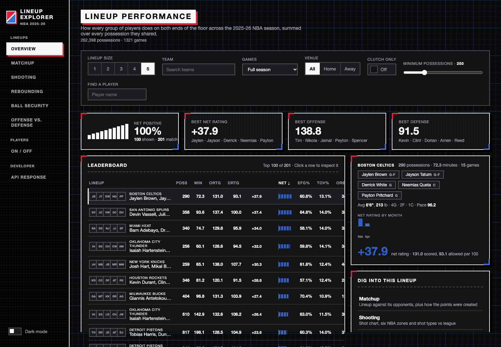
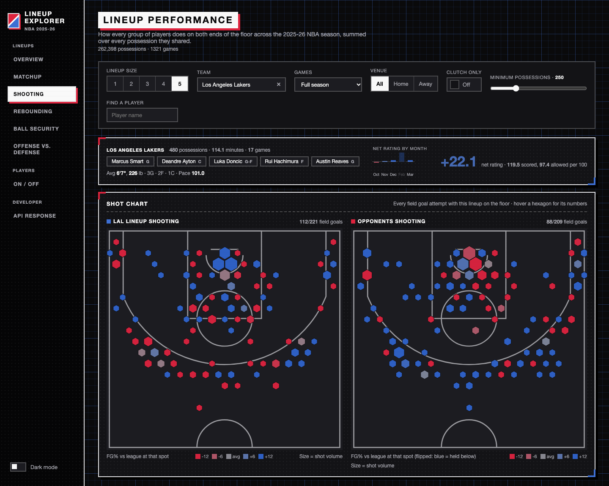
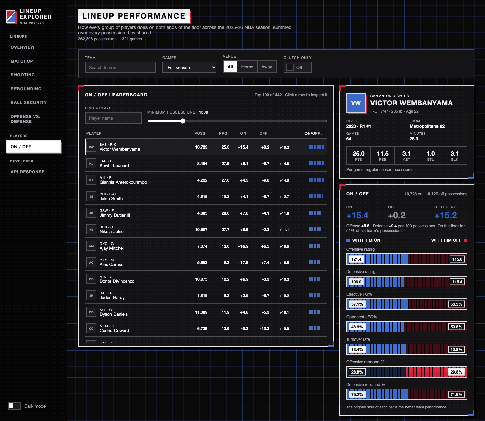

# NBA Lineup Explorer · 2025-26

**See which groups of NBA players actually work together, and which players make their team better.**

**Live site: https://nba-lineup-explorer.vercel.app**



## What it's for

Box scores tell you what one player did. They don't tell you how a team plays when a particular group of five
is on the court together, or how much worse it gets when a star sits down. Coaches and front offices care about
exactly that: which lineups to trust in a close game, who to pair with whom, and which players move the needle.

This dashboard answers those questions for every game of the 2025-26 NBA season, including the playoffs. It
works out who was on the floor for every one of the season's 262,398 possessions, then adds up how each lineup
did on offense and on defense.

## What you can do with it

- **Rank lineups**: sort every group of 1 to 5 players by net rating, offense, defense, shooting, turnovers or
  rebounding, for one team or the whole league.
- **Narrow the situation**: regular season or playoffs, home or away, and clutch time only (the last five
  minutes of a close game).
- **Open any lineup** to see:
  - **Matchup**: the lineup against its opponents, stat by stat, plus how its points were created (paint,
    fast breaks, second chances, off turnovers).
  - **Shooting**: a shot chart of where the lineup shot from, and how well, compared with the league in each of
    the six NBA court zones.
  - **Rebounding**: how it does on the glass, and how its height and positions compare.
  - **Ball security**: turnovers committed and forced, steals and blocks.
- **Judge players by on/off**: how a team performs with a player on the floor against the same team with him on
  the bench, plus his best two-man pairings and his bio.

<table>
  <tr>
    <td></td>
    <td></td>
  </tr>
</table>

## Key terms

| Term | Meaning |
|---|---|
| **Possession** | One trip down the floor by one team, ending in a made basket, a defensive rebound or a turnover. |
| **Offensive / defensive rating** | Points scored / allowed per 100 possessions. |
| **Net rating** | Offensive rating minus defensive rating. +10 means the lineup outscores opponents by 10 points per 100 possessions. |
| **On/off** | A team's net rating with a player on the floor minus its net rating with him on the bench. |
| **eFG%** | Field goal percentage that counts a three as 1.5 makes, since it's worth more. |
| **≈ Approx.** | A stat the data doesn't record directly, so it's estimated. Hover the badge in the app for how. |

Small samples are noisy: a lineup that played 20 possessions can have a wild net rating by luck. The
**minimum possessions** slider hides those.

## Where the data comes from

All numbers come from the public Kaggle dataset
[Historical NBA Data and Player Box Scores](https://www.kaggle.com/datasets/eoinamoore/historical-nba-data-and-player-box-scores)
by Eoin A. Moore (version 522). It doesn't list lineups directly, so they are rebuilt from the play-by-play:

- **Who's on the floor**: each game's box-score starters, then every substitution in order. For later quarters,
  any player who appears before being subbed in was already on the court.
- **Checks**: both lineups are known for 99.9% of possessions; the rest are left out. Rebuilt scores match the
  final score exactly in 97.7% of games, and league-wide rates (offensive rating 115.4, about 99 possessions per
  game, 54.4% eFG) match the real season.
- **Approximations**: two stats are estimated and marked **≈ Approx.** everywhere they appear:
  - *Shot-attempt points*: points from made field goals plus the and-one free throw that came with them.
  - *Free-throw potential points*: one potential point per free throw attempted.
- **Left out**: technical free throws (they don't belong to either lineup) and end-of-quarter heaves (under the
  NBA's 2025-26 rule they no longer count as shot attempts).

## How it's built

| Part | Technology |
|---|---|
| Frontend | Angular 21, hand-drawn SVG charts, hosted on Vercel |
| Backend | Django 5.2 and Django REST Framework, with pandas for the lineup math, hosted on Railway |
| Database | PostgreSQL for teams, games and players |
| Data pipeline | Python script that turns the Kaggle play-by-play into possessions and shots |

The season's possessions and shots (about 5 MB compressed) ship with the backend and are loaded into memory
once. Combining every lineup across 262,398 possessions takes under a second, and results are cached for each
filter combination.

```
backend/
  app/helpers/     lineup, player, shot and league calculations
  app/views/       API endpoints
  raw_data/        the season's data files, built by scripts/build_dataset.py
  scripts/         build_dataset.py (Kaggle -> raw_data), ingest_raw_data.py (raw_data -> Postgres)
frontend/
  src/app/lineups-summary/   the dashboard: filters, tabs and shared charts
docs/screenshots/            images used in this README
```

## Run it yourself

You'll need Python 3.12, Node.js 22 and PostgreSQL.

**1. Database**

```
createuser nbaapp --createdb
createdb -O nbaapp nba
psql nba -c "create schema app authorization nbaapp; alter user nbaapp with password 'nba';"
```

**2. Backend** (http://localhost:8000)

```
python3.12 -m venv .venv
.venv/bin/pip install -r backend/requirements.txt
cd backend
../.venv/bin/python manage.py migrate
PYTHONPATH=. ../.venv/bin/python scripts/ingest_raw_data.py
../.venv/bin/python manage.py runserver
```

Run the tests with `../.venv/bin/python manage.py test app`.

**3. Frontend** (http://localhost:4200)

```
cd frontend
npm install
npm start
```

**Rebuilding the data (optional).** `backend/raw_data/` is already included. To rebuild it from a newer Kaggle
version:

```
.venv/bin/pip install -r backend/requirements-data.txt
cd backend
../.venv/bin/python scripts/build_dataset.py                    # downloads the dataset (about 1.8 GB)
../.venv/bin/python scripts/build_dataset.py /path/to/dataset   # or use a copy you already have
```

## API

The backend is a public JSON API. For example,
[`/api/v1/lineups?lineup_size=5&min_possessions=300&limit=5`](https://backend-production-c7ac.up.railway.app/api/v1/lineups?lineup_size=5&min_possessions=300&limit=5)
returns the five best five-man lineups of the season.

| Endpoint | Returns |
|---|---|
| `GET /api/v1/lineups` | Lineup stats. Options: `lineup_size` (1-5), `team_id`, `player_ids`, `exclude_player_ids`, `search`, `min_possessions`, `sort_by`, `order`, `limit`, `offset`. The total row count is in the `X-Total-Count` header. |
| `GET /api/v1/lineups/trend` | One lineup's ratings month by month (`team_id`, `player_ids`). |
| `GET /api/v1/players` | Each player's on-court and off-court numbers, on/off difference, bio and per-game averages. |
| `GET /api/v1/shots` | Shot chart data and zone splits against league average, for a lineup's shots (`side=offense`) or its opponents' (`side=defense`). |
| `GET /api/v1/league` | League averages for the selected games. |
| `GET /api/v1/meta` | Season coverage, data notes and how the approximated stats are estimated. |
| `GET /api/v1/teams` | All 30 teams. |

Every endpoint also accepts `game_type` (`Regular Season`, `Play-In`, `Playoffs`), `location` (`home`, `away`),
`clutch=1`, `period`, `date_from` and `date_to`.

## Deployment

- **Backend (Railway)**: a Postgres service and a backend service rooted at `backend/`. Set `DATABASE_URL`
  (from the Postgres service), `DJANGO_SECRET_KEY`, `DJANGO_DEBUG=0` and `RAILPACK_START_CMD` (the start command
  in `backend/railway.json`, which Railway doesn't pick up for CLI uploads). Each deploy runs the migrations and
  loads teams, games and players. To deploy from your machine: `railway up backend --path-as-root --service backend`.
- **Frontend (Vercel)**: set the backend URL in `frontend/src/environments/environment.prod.ts`, then run
  `npx vercel deploy --prod` from `frontend/`, or import the repo in Vercel with `frontend` as the root directory.

## Credits

Data: [Eoin A. Moore on Kaggle](https://www.kaggle.com/datasets/eoinamoore/historical-nba-data-and-player-box-scores),
compiled from NBA play-by-play and box scores. This is an independent project and isn't affiliated with or
endorsed by the NBA or any team.
